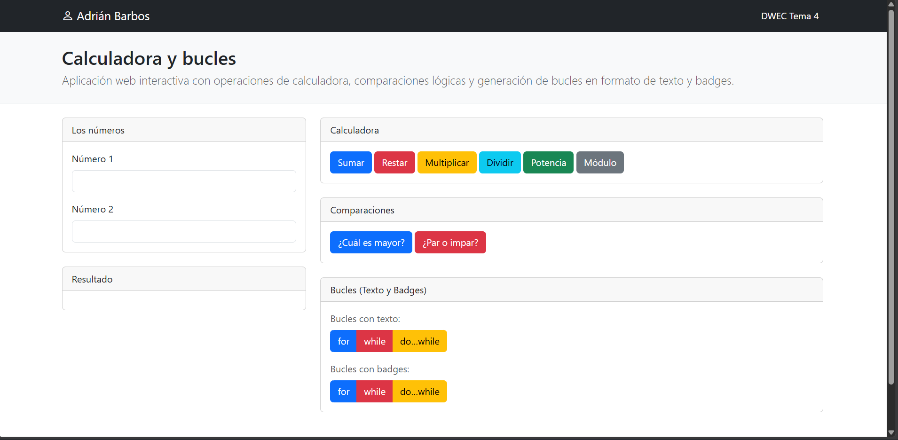
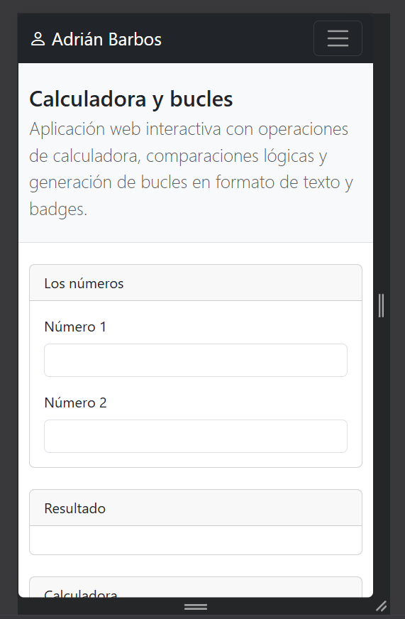
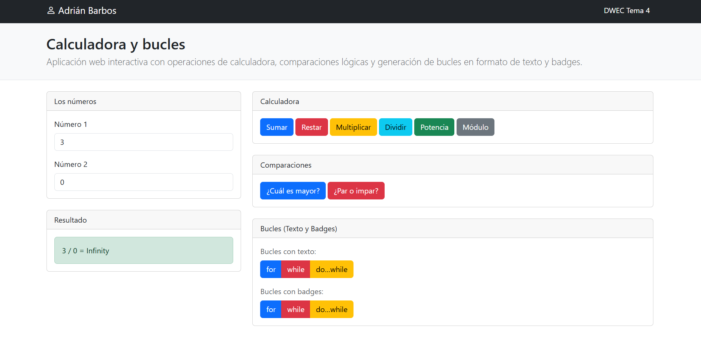
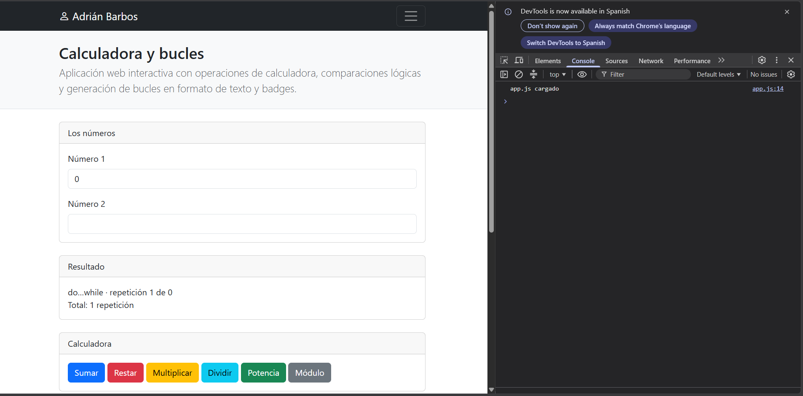
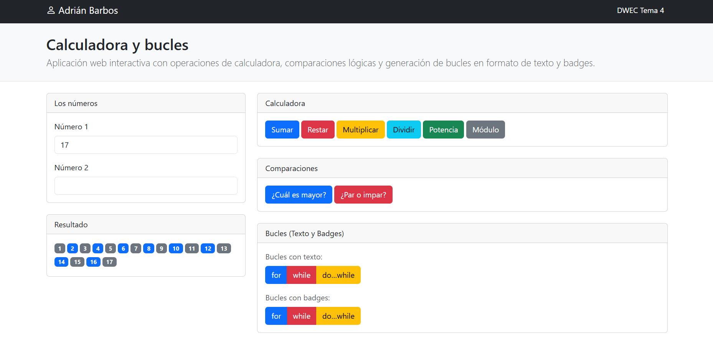

# Tarea 4 · Calculadora y bucles

**Autor:** Adrián Barbos · Desarrollo Web en Entorno Cliente (DWEC) · 2.º DAW · Curso 2026-27

> **Plantilla de la tarea 4.** Cómo usarla:
>
> 1. Copia esta carpeta en tu repositorio de DWEC y cámbiale el nombre a `tema04`.
> 2. `index.html` trae lo imprescindible para empezar: las dos casillas, la zona de resultado y el botón «Sumar». El resto de la página y su maquetación con Bootstrap los haces tú.
> 3. `js/app.js` trae `sumar()` hecha como modelo y las demás funciones con `TODO`.
> 4. `js/ayudas.js` no se toca: son las funciones que leen las casillas y escriben el resultado.
> 5. Sustituye las imágenes de `capturas/` por las tuyas, **con el mismo nombre**.
> 6. Todo lo que va entre [corchetes] es un hueco: cámbialo por lo tuyo. Al terminar, borra este aviso.

Contiene la aplicación web interactiva de calculadora y bucles desarrollada con Bootstrap y JavaScript. Para probarla, abre la carpeta en VS Code, inicia el servidor con Go Live, introduce dos números en los campos de entrada y haz clic en los botones de las operaciones o bucles.

## Capturas

### a) La página entera

Qué se ve: Se muestra el nombre del autor en la navbar y la interfaz organizada en dos columnas mediante Bootstrap: datos y resultados a la izquierda, y las secciones de acciones a la derecha.

### b) La página en el móvil

Las columnas se apilan verticalmente adaptándose a pantallas pequeñas.

### c) El error de dividir entre 0

Se observa que al dividir entre 0 la aplicación muestra el valor Infinity en la caja de resultados, con la consola limpia y sin errores de ejecución.

### d) Los tres bucles con el número 0

El bucle for y el while no se ejecutan (0 repeticiones) porque la condición es falsa desde el inicio. El do...while se ejecuta exactamente 1 vez porque evalúa la condición al final.

### e) Un bucle con badges

Se ha introducido el número 17 y el color de cada badge se alterna dinámicamente mediante operadores ternarios (pares de un color e impares de otro).

## Reflexión

Los bucles for y while evalúan su condición antes de cada iteración, por lo que al introducir un 0 no llegan a ejecutarse ninguna vez. En contraste, el bucle do...while comprueba la condición al final, lo que garantiza que el bloque de código se ejecute siempre al menos una vez, mostrando una repetición incluso con el 0. Usaremos for cuando sepamos el número exacto de repeticiones, while cuando el bucle dependa de una condición previa, y do...while cuando sea obligatorio realizar la acción antes de validar si se debe repetir.

## Fuentes

- [Título de la página](https://enlace-a-la-fuente)
- Gemini
- Los PDF de la asignatura

## Uso de IA

He usado IA para algunas cosas del README.md, para que me ordene también algunas cosas de bootstrap y con algunas dudas que he tenido en algún apartado.
