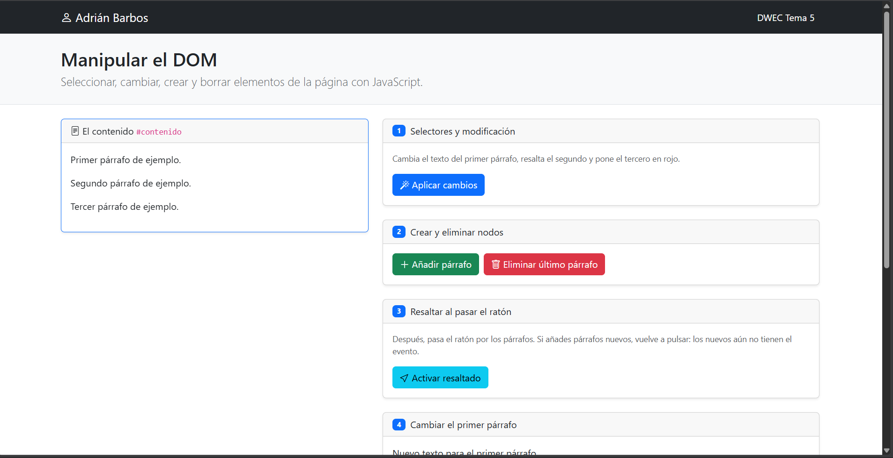
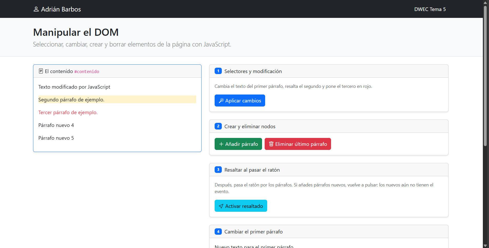
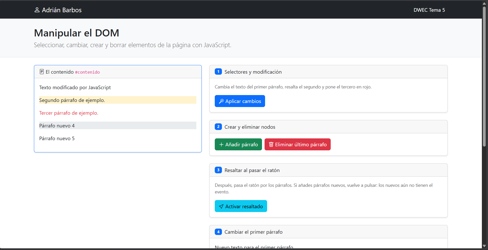
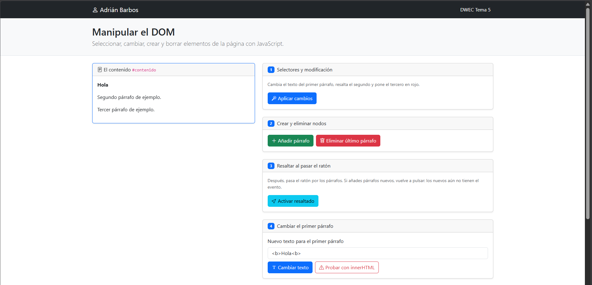
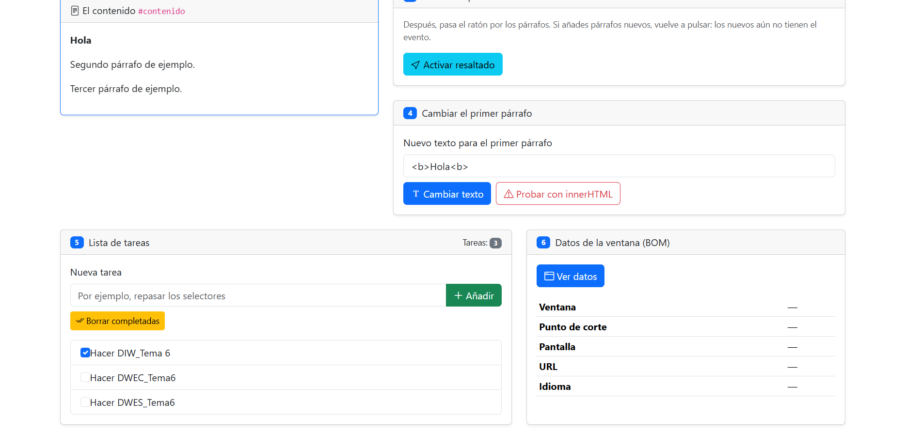
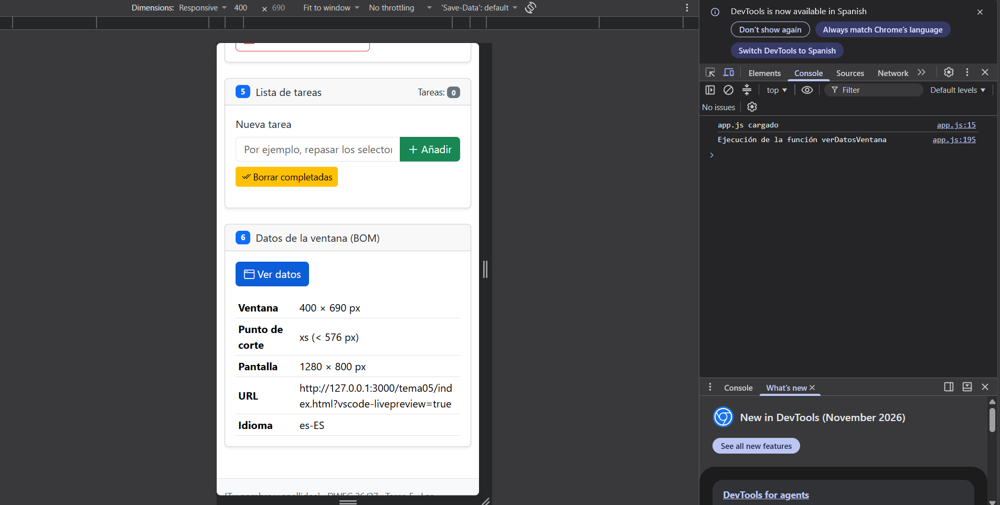

# Tarea 5 · Manipular el DOM

**Autor:** Adrián Barbos · Desarrollo Web en Entorno Cliente (DWEC) · 2.º DAW · Curso 2026-27

> **Plantilla de la tarea 5.** Cómo usarla:
>
> 1. Copia esta carpeta en tu repositorio de DWEC y cámbiale el nombre a `tema05`.
> 2. `index.html` ya está maquetado: es la página que vas a manipular. No cambies los `id` ni las clases que usa el JavaScript.
> 3. `js/app.js` trae una función por botón con `TODO`, y modelos en los ejercicios 1, 3 y 6.
> 4. Sustituye las imágenes de `capturas/` por las tuyas, **con el mismo nombre**.
> 5. Todo lo que va entre [corchetes] es un hueco: cámbialo por lo tuyo. Al terminar, borra este aviso.

[Una o dos líneas: qué hay en esta carpeta y cómo se ve. Por ejemplo: abrir la carpeta en VS Code, pulsar **Go Live** y probar los botones con la consola abierta (F12).]
En esta carpeta tema05 está, la carpeta de las capturas, la carpeta de js con el app.js dentro que es donde he tenido que trabajar en toda la práctica y finalmente el index. Al hacer clic derecho sobre el index.html y darle show preview aparece la web. Con f12 podemos ver que al pulsar un botón en la consola aparece "ejecución de la función" y el nombre de la función.
## Capturas

### a) La página recién cargada

En esta captura se ve mi nombre Adrián Barbos con el nav que utilizo siempre, los 3 párrafos dentro de "El contenido" y las tarjetas de los ejercicios.

### b) Ejercicios 1 y 2

Se han modificado los tres primeros párrafos utilizando los siguientes selectores: al primer párrafo se le ha cambiado el texto empleando document.getElementById('primero'); al segundo párrafo se le ha añadido un fondo resaltado mediante un selector de clase con document.querySelector('.segundo'); y al tercer párrafo se le ha cambiado el color del texto a rojo utilizando un selector de etiqueta por posición con document.querySelectorAll('#contenido p')[2].

### c) Ejercicio 3: resaltado al pasar el ratón

En esta captura se puede ver cómo el Párrafo nuevo 4 se encuentra resaltado al pasar el ratón por encima (gracias a los eventos mouseenter y mouseleave). Respecto a los párrafos que se añaden después, no tienen el evento activo de forma automática, por lo que si creas nuevos párrafos tras activar esta función, al pasar el ratón sobre ellos no se resaltarán a menos que se vuelva a pulsar el botón de activar.

### d) Ejercicio 4: `<b>hola</b>` con innerHTML

Con el botón de «Cambiar texto» (utilizando textContent), las etiquetas HTML no se interpretan y aparecen literalmente como texto plano en la pantalla. En cambio, al utilizar innerHTML, el navegador interpreta dichas etiquetas, haciendo que el texto se aplique con formato HTML (mostrándose en negrita gracias a la etiqueta <b>).

### e) Ejercicio 5: la lista de tareas

En la captura se muestra la lista con tres tareas creadas («Hacer DIW_Tema 6», «Hacer DWEC_Tema6» y «Hacer DWES_Tema6»), donde se aprecia el contador de tareas activo a 3 y la primera de ellas marcada con el checkbox de completada, justo antes de pulsar el botón de «Borrar completadas» para eliminarla del listado.

### f) Ejercicio 6: los datos de la ventana en el móvil

En el modo móvil el punto de corte es xs (< 576 px), mientras que en la pantalla del ordenador es xxl (≥ 1400 px).

## Reflexión

La principal diferencia entre textContent y innerHTML es que el primero trata el contenido estrictamente como texto plano, mientras que el segundo interpreta y procesa las etiquetas HTML. Como comprobamos con el ejemplo de <b>hola</b>, textContent muestra las etiquetas de forma literal en la pantalla, mientras que innerHTML renderiza el formato y aplica la negrita. No se debe introducir datos escritos por el usuario directamente mediante innerHTML porque representa un grave riesgo de seguridad: esto permite vulnerabilidades de inyección de código como ataques Cross-Site Scripting (XSS), donde un usuario malintencionado podría ejecutar scripts arbitrarios en la aplicación.

## Fuentes

- PDF Tema 5
- Tema 05 v2 Los objetos de lenguaje
- Gemini

## Uso de IA

He usado Gemini para comentar algunos apartados del código, para el apartado 5 lista de tareas ya que en los pdf no viene bien explicado y hay cosas que ni están explicadas, el código no lo copio y lo pego, uso la IA como ayuda y para que me explique partes del código que no se hacer y así poder entenderlas. También he usado IA para que me explique algunos apartados que no endendía de las funciones como por ejemplo lo del for...of. También cuando he estado haciendo los ejercicios y me han dado errores pues lo he consultado con la IA para que me ayude a arreglarlo y entender porque ha podido fallar.
