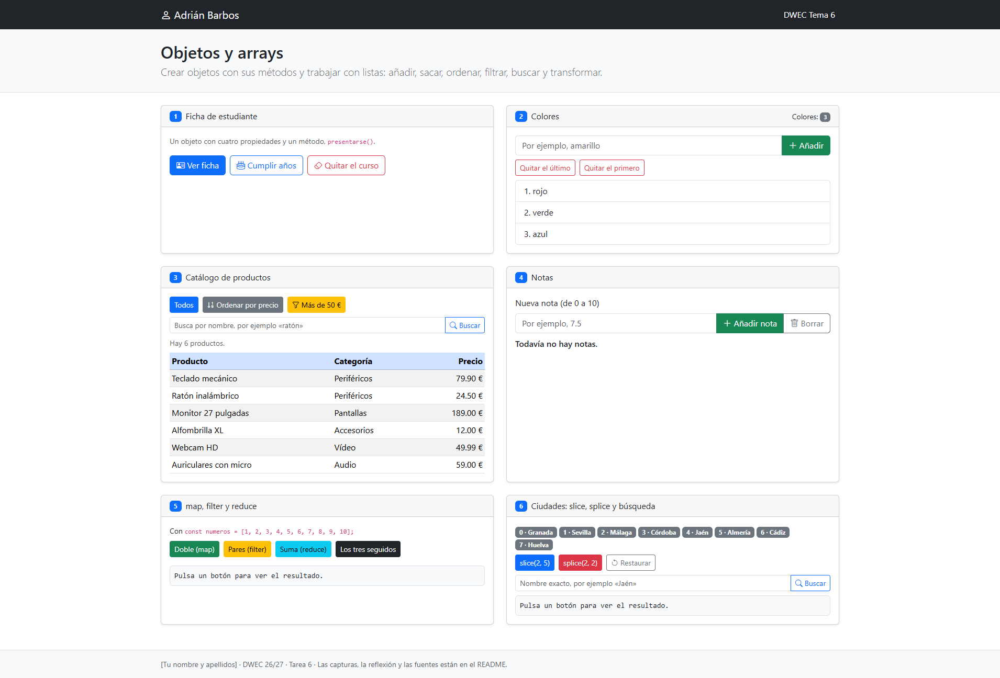
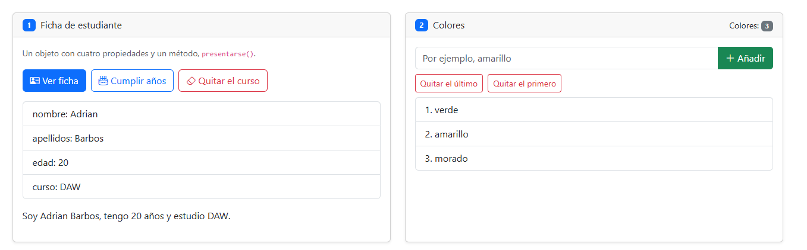
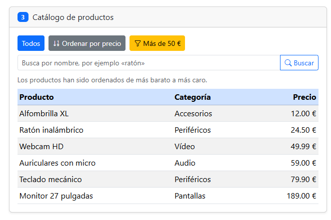
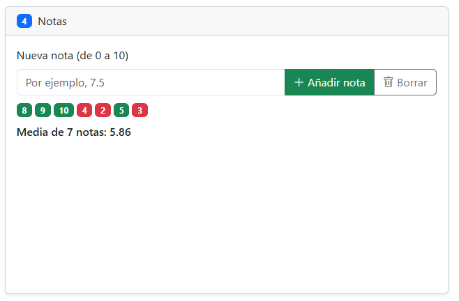
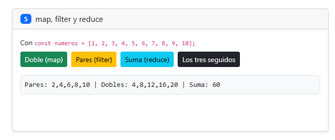
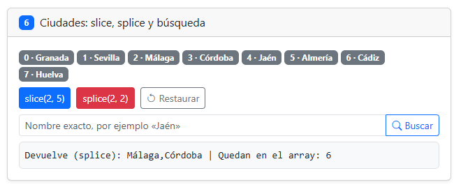

# Tarea 6 · Objetos y arrays

**Autor:** Adrián Barbos · Desarrollo Web en Entorno Cliente (DWEC) · 2.º DAW · Curso 2026-27

Esta carpeta contiene una práctica interactiva de JavaScript centrada en la manipulación de arrays (métodos como `map`, `filter`, `reduce`, `slice`, `splice`) y la interacción dinámica con el DOM. Para probarla, abre el proyecto en VS Code, inicia Live Preview con Live Server y explora las funcionalidades con la consola abierta (`F12`).

## Capturas

### a) La página recién cargada

Al cargar la página se puede ver la cabecera con mi nombre Adrián Barbos, el bloque de colores con su lista inicial, el catálogo completo de productos ordenados en su tabla y la lista de ciudades cargada con sus respectivos badges y posiciones.

### b) Ejercicios 1 y 2: la ficha y los colores

En la ficha del estudiante se muestra el estado tras pulsar el botón de cumplir años (la edad pasa a 20 y el método `presentarse()` refleja los nuevos datos). En el bloque de colores, se han utilizado los métodos de arrays `push` y `unshift` para añadir elementos, y `pop` y `shift` para eliminar el último o el primero respectivamente, actualizando dinámicamente la lista y el contador.

### c) Ejercicio 3: el catálogo ordenado por precio

Para ordenar el catálogo de productos por precio de más barato a más caro, he utilizado una función de comparación numérica restando `a.precio - b.precio`. Además, ordeno una copia del array (creada con el operador spread `[...]`) para evitar modificar el array original de productos y así poder volver a la vista inicial ("Todos") sin alterar el orden original.

### d) Ejercicio 4: las notas y la media

En este bloque se muestran un mínimo de cinco notas añadidas, diferenciando visualmente entre aprobadas (en verde) y suspensas (en rojo) mediante clases dinámicas, y calculando automáticamente la nota media de todas ellas utilizando el método `reduce`.

### e) Ejercicio 5: los tres métodos seguidos

En este ejercicio encadenamos tres métodos: primero con `filter` nos quedamos solo con los números pares `[2, 4, 6, 8, 10]`, después con `map` duplicamos esos valores obteniendo `[4, 8, 12, 16, 20]`, y por último con `reduce` sumamos todos los elementos de ese nuevo array, dando como resultado final **60**.

### f) Ejercicio 6: después de splice y de buscar una ciudad

Con la función `splice(2, 2)` se han eliminado las ciudades de Málaga y Córdoba (que ocupaban las posiciones 2 y 3). Al realizar la búsqueda de una ciudad como Jaén, el método `indexOf()` devuelve su posición actual en el array resultante tras el recorte, permitiendo comprobar su índice dinámicamente.

## Reflexión

Algunos métodos de JavaScript modifican el array original como hace splice mientras que otros devuelven uno nuevo como hace slice. Por ejemplo en el ejercicio seis slice solo extrae una parte sin tocar el array original pero splice borra los elementos directamente modificando la estructura. Por eso mismo en el ejercicio tres ordenamos una copia del array de productos para no alterar los datos originales y poder volver a la vista inicial intacta.

## Fuentes

- Tema 6 Estructura de datos. El array
- PDF Estructura de datos. El array
- Gemini 

## Uso de IA

He utilizado Gemini como herramienta de apoyo para resolver algunas dudas de código y fallos puntuales que me iban saliendo. Cuando una función no me iba y no sabía por qué, consultaba a la IA, entendía el error y luego ya corregía el código por mí mismo. También la he usado para que me ayude un poco con el README.md. 
