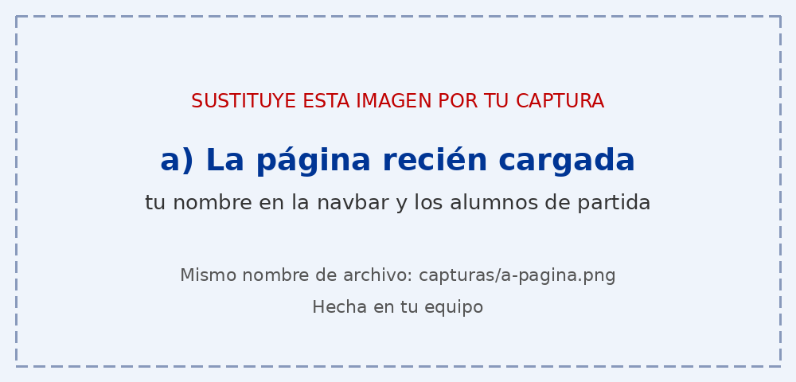
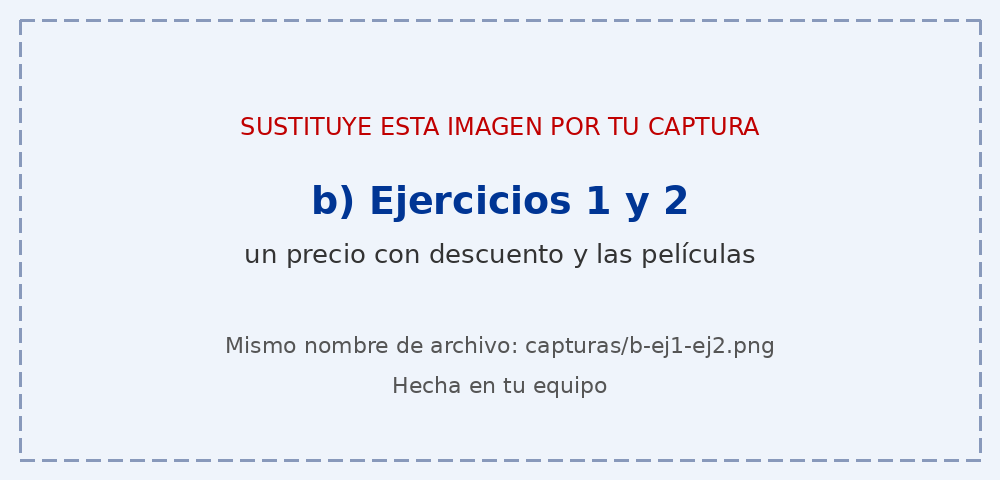
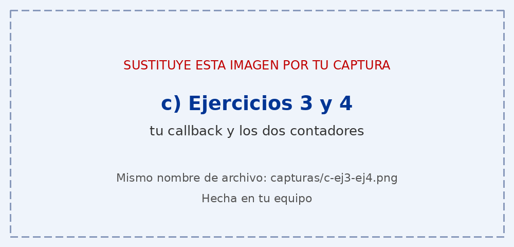
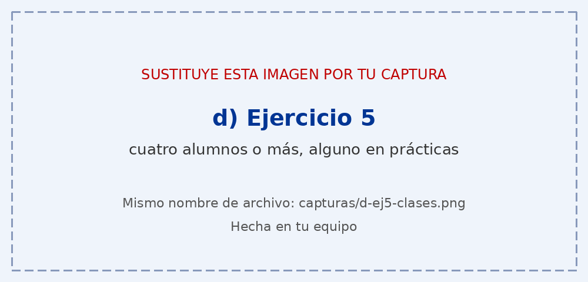
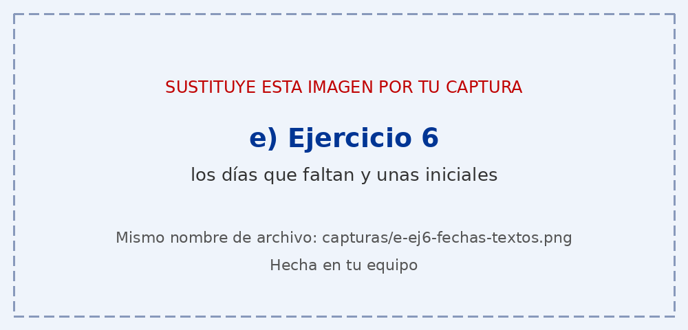

# Tarea 7 · Funciones, flechas y clases

**Autor:** [Tu nombre y apellidos] · Desarrollo Web en Entorno Cliente (DWEC) · 2.º DAW · Curso 2026-27

> **Plantilla de la tarea 7.** Cómo usarla:
>
> 1. Copia esta carpeta en tu repositorio de DWEC y cámbiale el nombre a `tema07`.
> 2. `index.html` ya está maquetado: una card por ejercicio (el 6 tiene dos). No cambies los `id` ni el `onclick` de los botones.
> 3. `js/app.js` trae una función por botón con `TODO`. Ya están hechas `pintarLista()`, `formatearEuros()`, `pintarAlumnos()` y un modelo en los ejercicios 3, 4 y 6.
> 4. Flechas en todos los callbacks y nunca una flecha como método. Las funciones de los botones, con `function`.
> 5. Sustituye las imágenes de `capturas/` por las tuyas, **con el mismo nombre**.
> 6. Todo lo que va entre [corchetes] es un hueco: cámbialo por lo tuyo. Al terminar, borra este aviso.

[Una o dos líneas: qué hay en esta carpeta y cómo se ve. Por ejemplo: abrir la carpeta en VS Code, pulsar **Go Live** y probar los botones con la consola abierta (F12).]

## Capturas

### a) La página recién cargada

[Qué se ve nada más cargar: tu nombre y los dos alumnos de partida.]

### b) Ejercicios 1 y 2: el precio y las películas

[Un precio con descuento y uno de los botones de las películas. Qué hace calcularPrecio() y qué hace mostrarPrecio().]

### c) Ejercicios 3 y 4: tu callback y los contadores

[Qué hace transformar() por dentro y por qué cada contador lleva su propia cuenta.]

### d) Ejercicio 5: los alumnos

[Al menos cuatro alumnos, alguno en prácticas. Cómo decide tu código si crea un Alumno o un AlumnoFCT.]

### e) Ejercicio 6: fechas y textos

[Qué fecha has probado, cuántos días salen y por qué redondeas.]

## Reflexión

[De 5 a 8 líneas: ¿qué cambia al pasar un callback de function a flecha? ¿Cuándo hace falta el return? ¿Por qué un método no se escribe con flecha? Pon un ejemplo de tu propio código.]

## Fuentes

- [Título de la página](https://enlace-a-la-fuente)

## Uso de IA

[Si has usado IA: qué herramienta, para qué y qué hiciste después con su respuesta. Si no la has usado, borra este apartado.]
